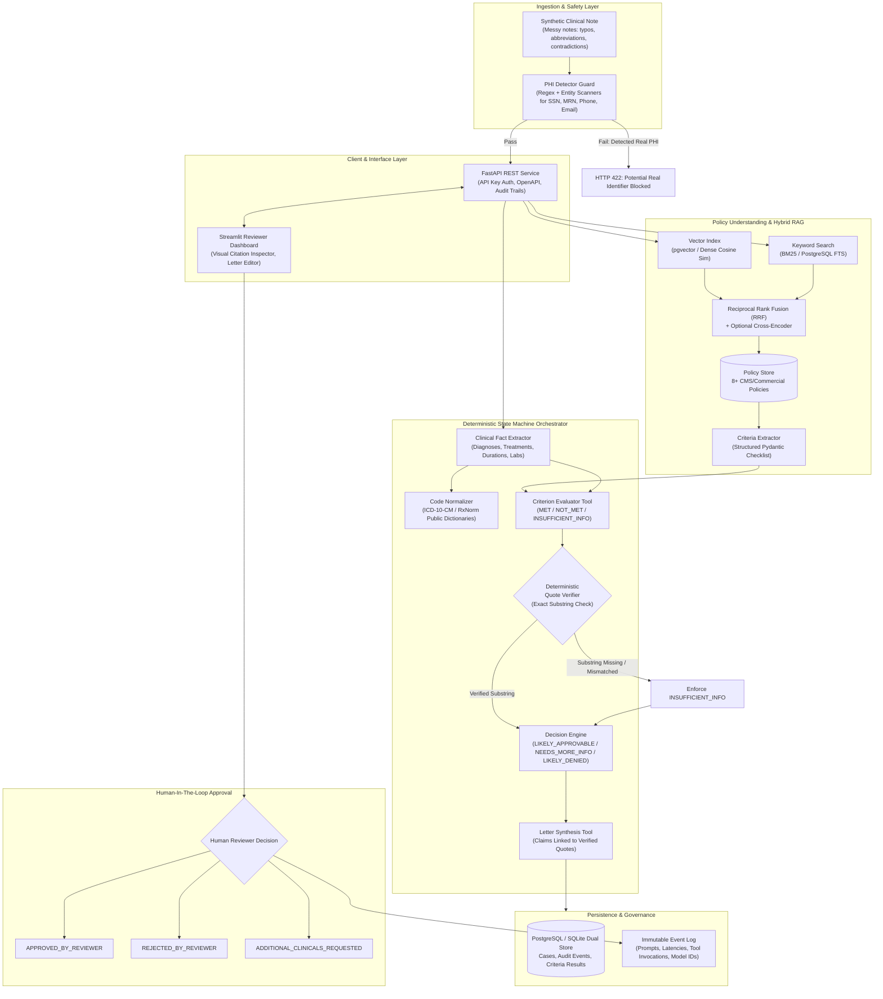
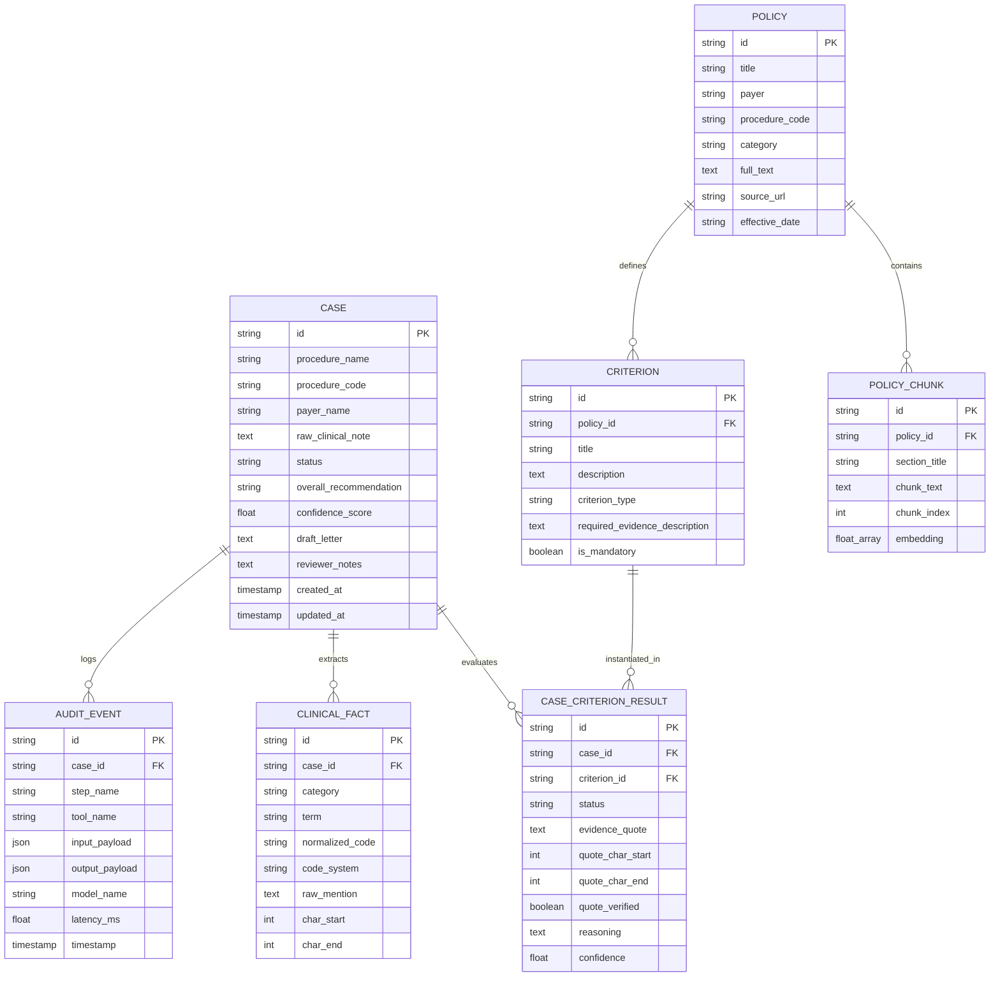

# Production-Grade Prior Authorization Agent: Architecture & Plan

> **DISCLAIMER:** Demo only. Not medical or coverage advice. Do NOT use with real Protected Health Information (PHI).

---

## 1. Executive Summary & Problem Framing

Prior authorization (PA) represents an estimated \$30B+ in annual administrative waste across the US healthcare system. Providers spend hours manually scouring clinical records to justify procedures and medications against fragmented, complex payer coverage policies (such as CMS National/Local Coverage Determinations and commercial Clinical Coverage Guidelines). 

This project implements an enterprise-ready, deterministic, safety-guarded **Prior Authorization Copilot Agent**. The agent assists human clinical reviewers by:
1. Identifying relevant payer coverage policies through hybrid retrieval (dense vector embeddings + BM25/FTS merged with Reciprocal Rank Fusion).
2. Decomposing policies into discrete, structured clinical criteria with Pydantic schemas.
3. Extracting clinical facts and mapping ICD-10/RxNorm codes while preserving exact character offsets from the raw note.
4. Evaluating each criterion using a deterministic state machine and verifying that every supporting citation is an exact, character-level substring of the input clinical note. If no verifiable quote exists, the agent strictly falls back to `INSUFFICIENT_INFO`.
5. Generating a structured prior authorization request packet and letter.
6. Enforcing a strict Human-In-The-Loop (HITL) gate: the system **never** makes autonomous final decisions.

---

## 2. System Architecture

---

## 3. Data Model Specification

### Core Entities & States
1. **Case Status**: `SUBMITTED`, `ANALYZING`, `ANALYZED`, `UNDER_REVIEW`, `APPROVED_BY_REVIEWER`, `REJECTED`
2. **Criterion Status**: `MET`, `NOT_MET`, `INSUFFICIENT_INFO`
3. **Overall Recommendation**: `LIKELY_APPROVABLE`, `NEEDS_MORE_INFO`, `LIKELY_DENIED`
4. **Invariant 1 (PHI Invariant)**: Ingestion halts immediately if SSN, direct phone, or non-synthetic identity markers are flagged.
5. **Invariant 2 (Evidence Invariant)**: A criterion status can be `MET` **if and only if** `evidence_quote` is an exact substring of `raw_clinical_note` (`raw_note[start:end] == evidence_quote`). If substring check fails or quote is absent, status is coerced to `INSUFFICIENT_INFO`.

---

## 4. Phase Breakdown & Implementation Task List

| Phase | Milestone & Scope | Key Artifacts |
|---|---|---|
| **Phase 1** | Repo setup, public policy curation (8 policies), synthetic dataset generation (100+ cases with ground truth) | `data/policies/*.json`, `data/synthetic_notes.jsonl`, `docs/DATA_NOTES.md`, `src/core/phi.py` |
| **Phase 2** | Chunking, hybrid search (dense + BM25 with RRF), and criteria extractor with Pydantic validation and caching | `src/retrieval/`, `src/policy/`, `tests/test_retrieval.py` |
| **Phase 3** | Clinical note fact extraction, ICD-10/RxNorm normalization, character offset alignment | `src/clinical/`, `data/terminology/`, `tests/test_clinical.py` |
| **Phase 4** | Prior Auth State Machine Agent with tools, exact quote verification, decision logic, letter drafting, and audit logging | `src/agent/`, `src/tools/`, `tests/test_agent.py`, `tests/test_quote_verification.py` |
| **Phase 5** | FastAPI endpoints (`/cases`, `/review`, `/policies`, `/health`), API key auth, and Streamlit Reviewer Workspace | `src/api/`, `src/ui/`, `tests/test_api.py` |
| **Phase 6** | Comprehensive Evaluation Suite: 100+ test cases, 20+ edge cases, Recall@k, per-criterion F1, critical error rate, faithfulness judge, ablations, `make eval` | `eval/`, `eval/results/`, `Makefile`, `tests/test_eval_smoke.py` |
| **Phase 7** | Quality, Docker/compose, GitHub Actions, Makefile, complete documentation, weaknesses, and interview presentation | `Dockerfile`, `docker-compose.yml`, `docs/DESIGN_DECISIONS.md`, `docs/LIMITATIONS.md`, `README.md` |

---

## 5. Technology Choices & Justification

- **No Heavy Framework Abstractions**: No LangChain / LlamaIndex wrappers. Pure Python 3.11 with explicit typing, Pydantic v2 schemas, and standard async design.
- **Hybrid Search with RRF**: Healthcare documents feature both semantic concepts (e.g. "conservative management failed") and exact alphanumeric codes (e.g. `CPT 72148`, `ICD-10 M54.5`). Dense vectors alone miss exact code tokens; BM25 alone misses semantic synonyms. Reciprocal Rank Fusion ($RRF = \sum \frac{1}{60 + \text{rank}_i}$) balances both optimally.
- **Programmatic Exact-Quote Verifier**: Eliminates hallucinated approvals. The LLM output must pass a character-level slice check before any approval recommendation is computed.
- **Provider-Agnostic LLM Client**: Unified interface supporting OpenAI, Gemini, Anthropic, as well as an offline Deterministic Mock Engine so test suites and evaluations run identically in CI without network or API key dependencies.

